# Etapa 3

Na etapa 3, objetiva-se:
- Detalhar esquemático/layout da PCB;
- Fabricar a PCB;
- Montar o protótipo;
- Realizar testes;
    - Teste do papel alumínio;
    - Teste de resistência mecânica e de temperatura;
    - Teste de limpeza.

## 1. Projeto dos Blocos

A Figura 1 representa um breve diagrama de blocos do projeto. A cor vermelha representa conexões de potência, enquanto a cor preta representa conexões analógicas. O esquemático completo pode ser acessado em [hardware/pcb](./hardware/pcb/). 

A explicação detalhada dos blocos encontra-se em [hardware](./hardware/README.md).

<h5>Figura 1: Breve diagrama de blocos</h5>
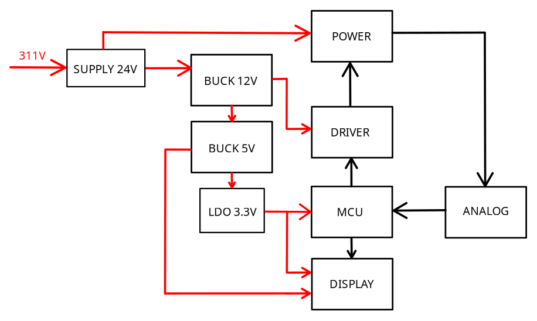

  

### 1.2 Layout da PCB

#### Descrição

O layout da placa foi feita em duas layers com pĺano de GND, com componentes SMD e THT e com dimensões 85x70 mm. Os arquivos KiCad podem ser acessados em [hardware/pcb](./hardware/pcb).

#### Front Layer

A maior parte dos componentes está situado na front layer.
A placa foi roteada por setores, seguindo o esquemático. As trilhas na entrada e no primário do transformador são mais "gordas" pois há mais corrente, diferente das trilhas do setor do microcontrolador que são finas pois há baixa corrente. Tentamos realizar o roteamento de forma que haja um plano de GND contínuo para garantir um bom caminho de retorno da corrente.

A Figura 2 mostra o layout da front layer enquanto a Figura 3 mostra a visão 3D da placa com marcações dos setores para melhor entendimento.

<table align="center">
  <tr>
    <td align="center">
    <h5>Figura 2: Front layer</h5>
      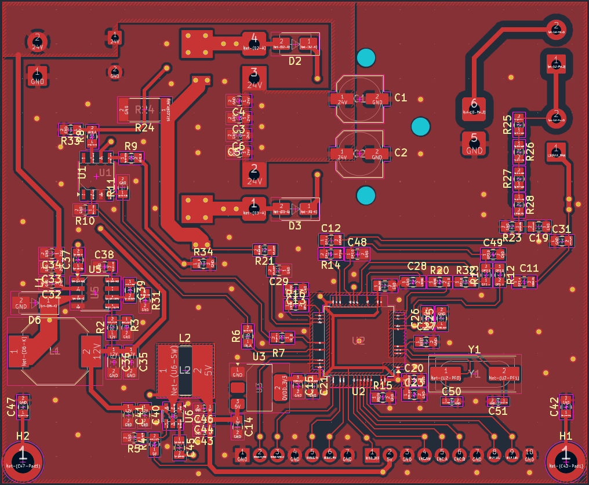
    </td>
    <td align="center">
    <h5>Figura 3: Back layer soldada</h5>
      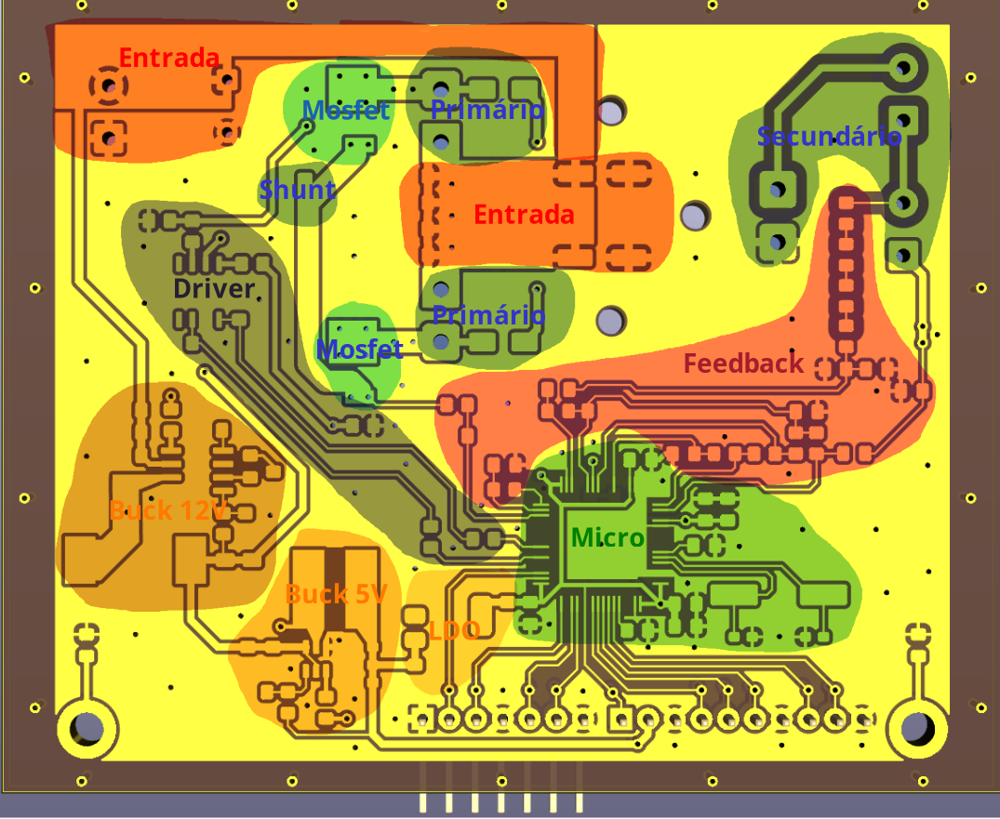
    </td>
  </tr>
</table>

#### Back Layer

Na back layer estão os componentes THT como conectores e transformador e alguns componentes SMD como mosfets.

A Figura 4 mostra o layout da back layer enquanto a Figura 5 mostra a visão 3D da placa com marcações dos setores para melhor entendimento.

<table align="center">
  <tr>
    <td align="center">
    <h5>Figura 4: Back layer</h5>
      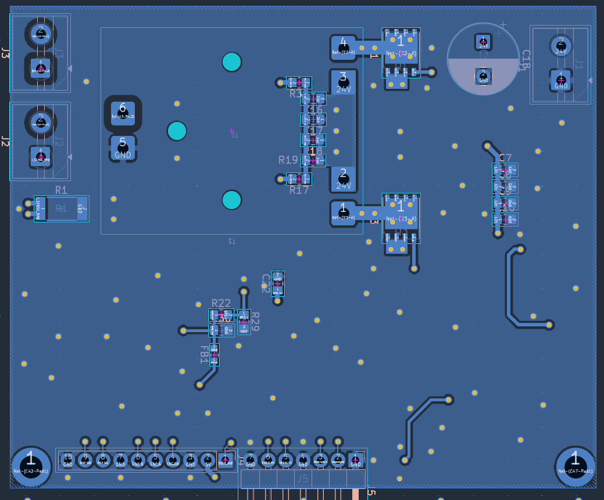
    </td>
    <td align="center">
    <h5>Figura 5: Back layer 3D</h5>
      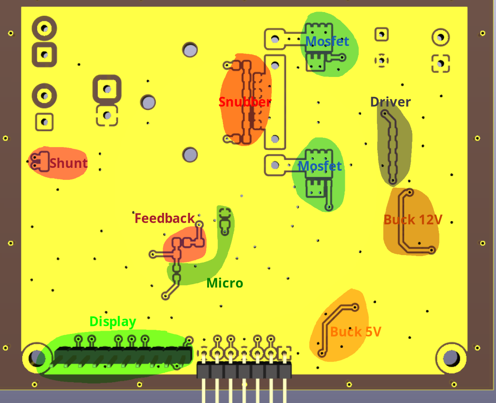
    </td>
  </tr>
</table>

#### Layers Sobrepostas

A Figura 6 mostra ambas as layers sobrepostas para visualização completa.

<h5>Figura 6: Layers sobrepostas</h5>
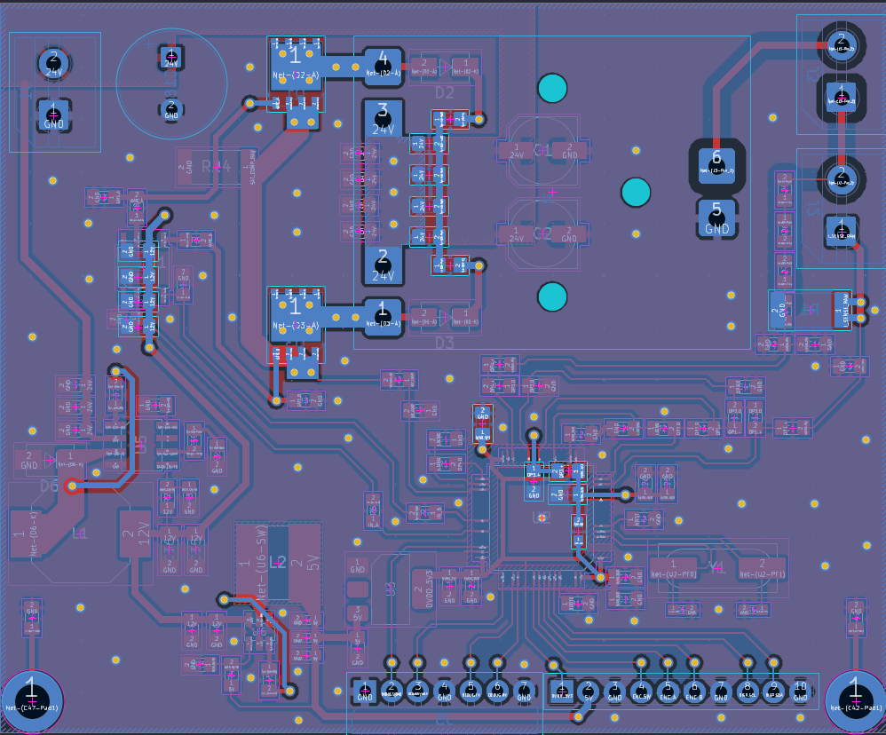

  

### 1.3 Fabricação da PCB

#### Método de Fabricação

A placa foi primeiro cortada e perfurada com uma CNC e a tranferência do padrão foi feita usando a técnica de litografia UV com uma impressora de resina. Depois, foi corroída com percloreto de ferro e finalizada com banho de prata. Os arquivos gerber podem ser acessados em [hardware/pcb](./hardware/pcb).

Fo utilizado o [UVTools](https://github.com/sn4k3/UVTools) para converter os arquivos para impressoras 3D de resina

#### Resultado

<table align="center">
  <tr>
    <td align="center">
    <h5>Figura 7: Front layer</h5>
      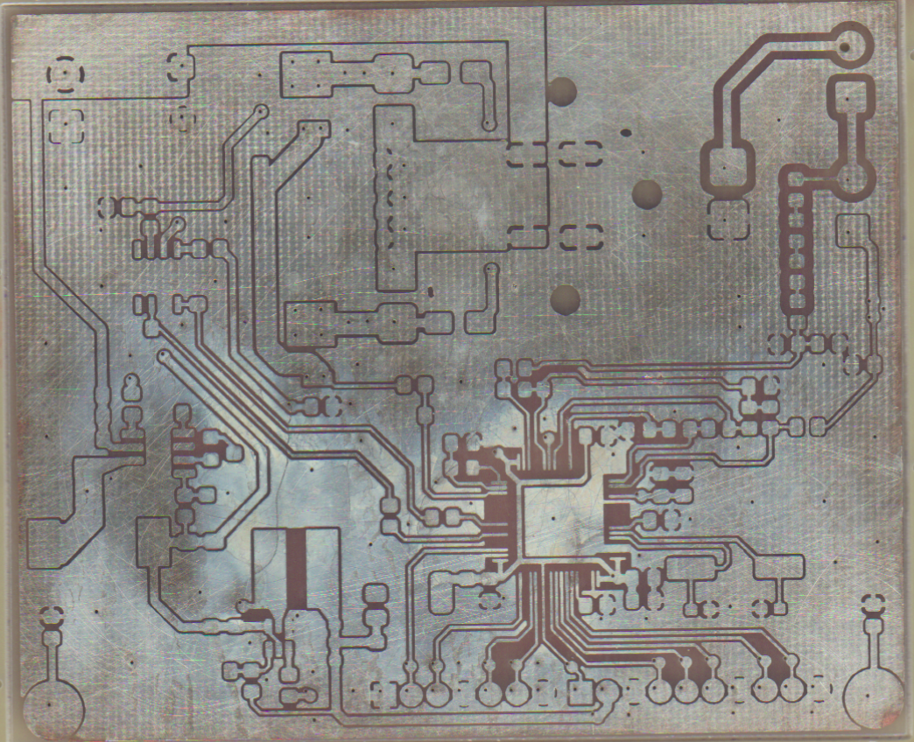
    </td>
    <td align="center">
    <h5>Figura 8: Front layer soldada</h5>
      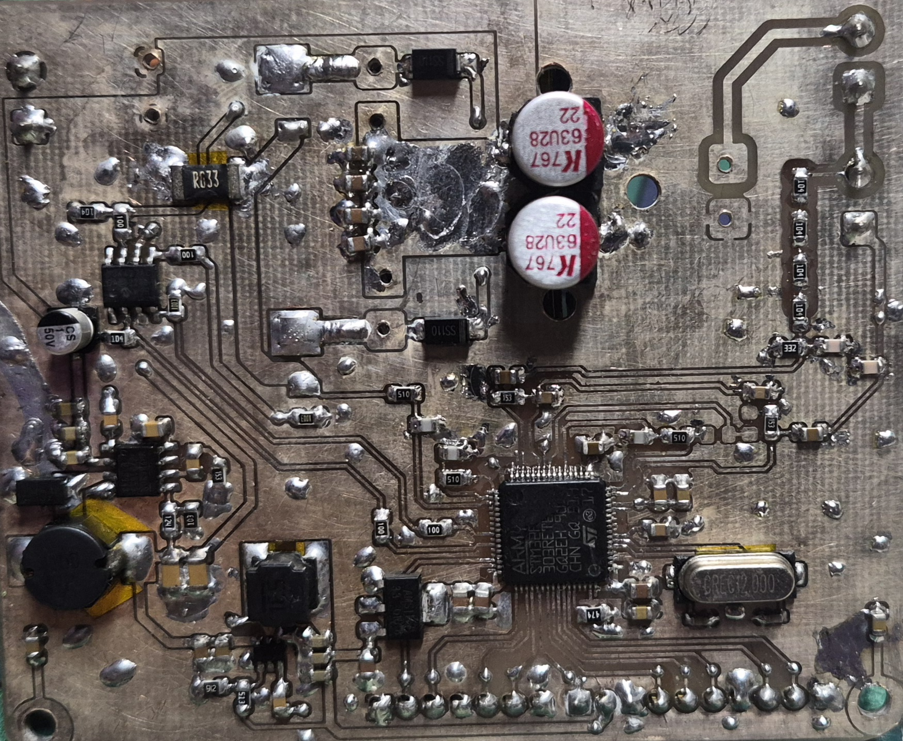
    </td>
  </tr>
</table>

<table align="center">
  <tr>
    <td align="center">
    <h5>Figura 9: Back layer</h5>
      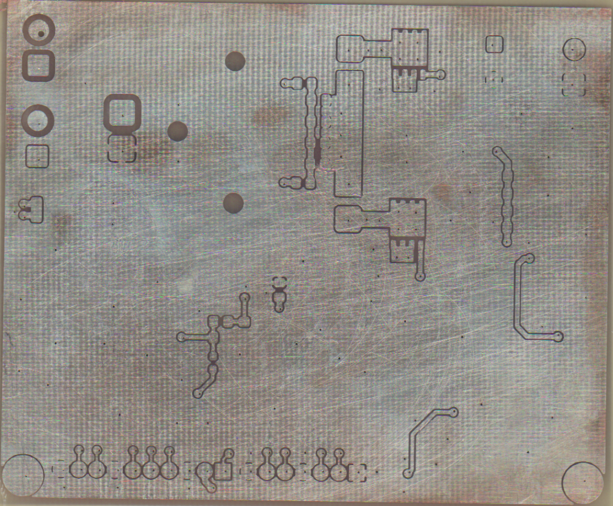
    </td>
    <td align="center">
    <h5>Figura 10: Back layer soldada</h5>
      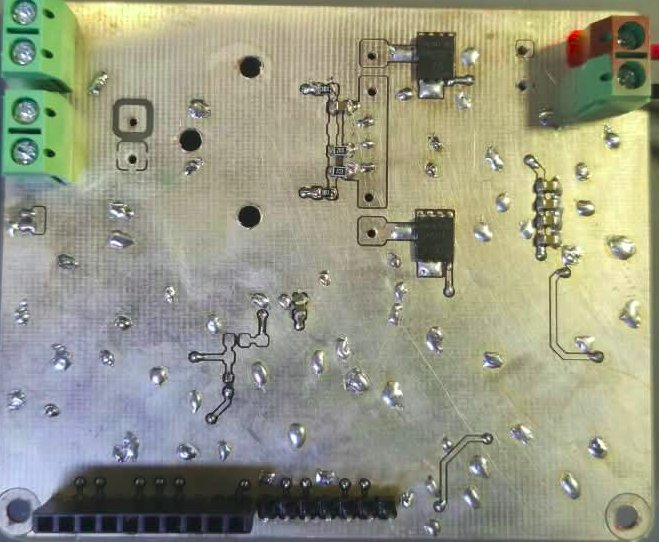
    </td>
  </tr>
</table>

Posteriormente o transformador foi fabricado e soldado na placa, como mostrado na Figura 11. Os cálculos do transformador serão desenvolvidos no tópico 1.4.

<h5>Figura 11: Placa com transformador</h5>
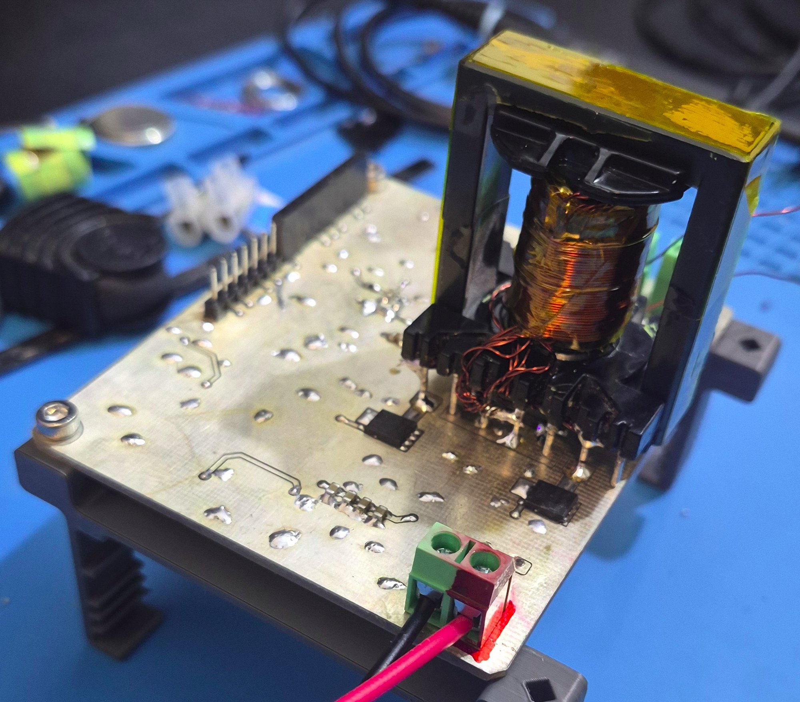

  

---

### 1.4 Fabricação do Transformador

#### 1.4.1 Especificações de Projeto 

As especificações de projeto são mostradas na tabela abaixo: 

 

| Categoria | Parâmetro | Símbolo | Valor | Unidade | Observação |
| :--- | :--- | :--- | :--- | :--- | :--- |
| **Potência** | Potência do Piezo (Carga) | $P_{piezo}$ | 35 | W | |
| | Potência de Trabalho (Projeto) | $P$ | 30 | W | Superdimensionado para folga |
| **Primário** | Tensão do Primário | $V_{pri}$ | 24 | V | |
| | Corrente do Primário | $I_{pri}$ | 1,25 | A | |
| **Secundário** | Tensão do Secundário (RMS) | $V_{sec}$ | 122 | V | |
| | Corrente do Secundário (RMS) | $I_{sec}$ | 0,24 | A | |
| **Segurança** | Densidade de Corrente Segura | $J$ | 2 | A/mm² | |
| | Profundidade Pelicular (Pior caso) | $\delta$ | 0,47 | mm |
| **Núcleo** | Tipo de Núcleo | - | ETD | - | Formato E duplo, cilindro central |
| | Fator de Indutância | $A_L$ | 1,83 | $\mu H/espiras^2$ | Média obtida experimentalmente |
| | Área da Seção Transversal Efetiva | $A_e$ | 107 | mm² | Calculada com $D = 11$ mm |
| | Área da Janela do Carretel | $A_w$ | 155 | mm² | Calculada com $27,2 \times 5,7$ mm |

> Obs.: Para mais detalhes sobre como as especificações foram obtidas, clique [aqui](/etapa_3/especificacao_fundamentacao.md). As especificações do núcleo foram obtidas empíricamente, conforme descrito no arquivo.
 

#### 1.4.2 Dimensionamento da Bitola dos Cabos

Levando em consideração as especificações da tabela anterior, obteve-se os parâmetros de bitola para o primário e secundário, conforme a tabela abaixo.

| Parâmetro | Símbolo | Valor | Unidade | Observação / Equivalência |
| :--- | :--- | :--- | :--- | :--- |
| **Primário** | | | | |
| Diâmetro teórico máximo | $D_{pri}$ | 0,47 | mm |  |
| Diâmetro elementar | $D_{pri\,elem}$ | 0,5150 | mm | Calculado para $N=3$ |
| **Bitola comercial adotada** | - | **0,57** | **mm** | **Fio 23 AWG** |
| **Secundário** | | | | |
| Diâmetro teórico mínimo | $D_{sec}$ | 0,8849 | mm | Calculado para $I = 1,230$ A |
| Diâmetro elementar | $D_{sec\,elem}$ | 0,5109 | mm | Calculado para $N=3$ |
| **Bitola comercial adotada** | - | **0,51** | **mm** | **Fio 24 AWG** |

> Obs.: Para mais detalhes sobre como os parâmetros foram obtidos, clique [aqui](/etapa_3/especificacao_fundamentacao.md).

#### 1.4.4 Dimensionamento do número de Espiras

**Primário**: o número de espiras do primário é obtido pela lei de Faraday para uma onda quadrada:

$$
N_P = \frac{V_Pt_{on}}{4B_{max}A_e}
$$

Onde:
- $V_P$: tensão de pico aplicada em **metade** do primário;
- $t_{on}=TD$: tempo efetivo de condução, onde T é o período de onda, e D o duty cycle;
- $B$: densidade de fluxo magnético de projeto (com margem de segurança em relação ao $B_{max}$ do material)
- $A_e$: área da seção transversal efetiva do núcleo

.: A saturação do núcleo depende do produto tensão-tempo aplicado ao enrolamento (volt-segundo). O pior caso ocorre quando a tensão de entrada é máxima e o tempo de condução é máximo (50% do período).

**Secundário:** 

Pela relação de transformação do conversor push-pull:

$$
\frac{V_S}{V_P} = 2 \, \frac{N_S}{N_P}D
$$

$$
N_S = \frac{1}{2} \left( \frac{V_S}{V_P} \right) \left( \frac{N_P}{D} \right)
$$

O valor final deve ser **arredondado para cima**.

#### 1.4.5 Verificação da Área de Cobre

Antes de enrolar, é necessário confirmar que todo o cobre cabe fisicamente na janela do carretel. Calcula-se a **Área de Cobre Nua (BCA)** de cada enrolamento:

$$
BCA = \sum_{i} \left( N_i \cdot m_i \cdot \pi \, r_i^2 \right)
$$

Onde, para cada enrolamento $i$:
- $N_i$: número de espiras (considerando as duas metades quando houver tomada central)
- $m_i$: número de fios em paralelo por espira
- $r_i$: raio do fio elementar

Compara-se então com a área da janela do carretel ($A_w$):

$$
\text{Área Utilizada} = \frac{BCA}{A_w} \times 100
$$

**Critério de aprovação:** $BCA$ deve ficar entre $35\%$ e $40\%$ de $A_w$.

- $> 40\%$: o cobre não cabe $\rightarrow$ escolher núcleo/carretel maior
- $\ll 40\%$: núcleo superdimensionado $\rightarrow$ escolher núcleo menor

Os $60$–$65\%$ restantes são destinados a isolamento do esmalte, fator de empacotamento, fita isolante, tubos termorretráteis e espaços vazios.

---

## 2 Testes e Ajustes

### Bucks e LDO

Primeiro verificamos se a conversão de energia estava estável. Podemos ver que as tensões estão corretas e estáveis o suficiente pela medida "Avg" na parte inferior das Figuras 12, 13, e 14.

A Figura 15 mostra o setup de teste com uma fonte de bancada gerando a tensão de entrada de 24V.

<table align="center">
  <tr>
    <td align="center">
    <h5>Figura 12: Buck 12V</h5>
      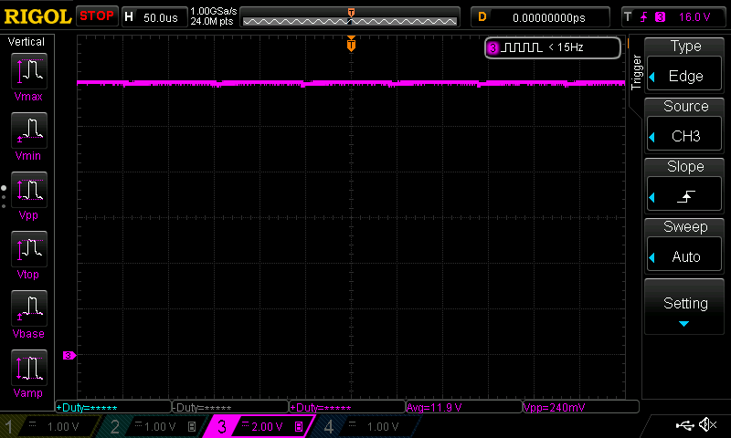
    </td>
    <td align="center">
    <h5>Figura 13: Buck 5V</h5>
      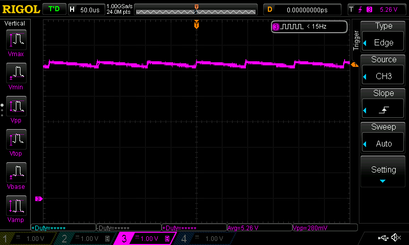
    </td>
    <td align="center">
    <h5>Figura 14: LDO</h5>
      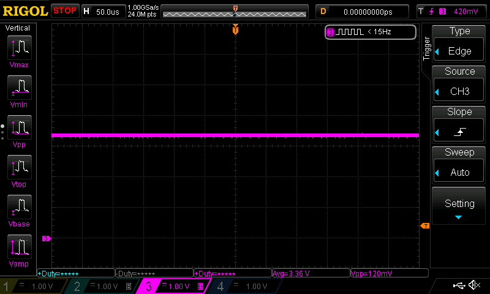
    </td>
  </tr>
</table>

<h5>Figura 15: Tensão de entrada</h5>
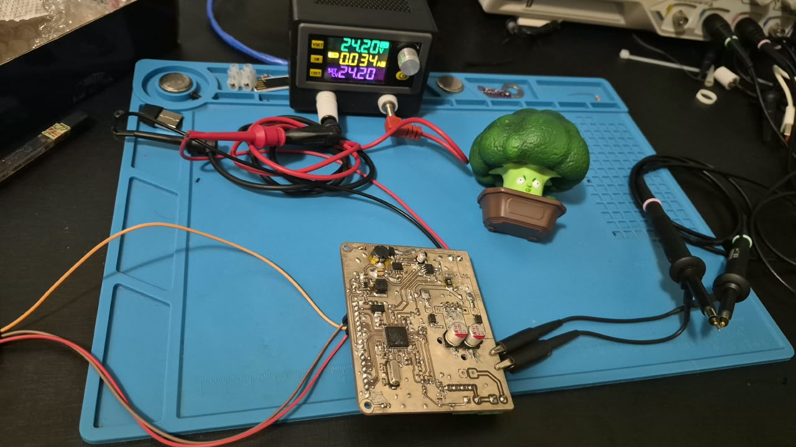

  

### PWM

O PWM foi configurado conforme na CubeMX da seguinte forma:
- Center Aligned mode 1
- Asymmetric PWM mode 1
- CH1 polarity: HIGH
- CH2 polarity: LOW

A representação gráfica da configuração e o resultado estão apresentados respectivamente nas Figuras 16 e 17.

<table align="center">
  <tr>
    <td align="center">
    <h5>Figura 16: PWM</h5>
      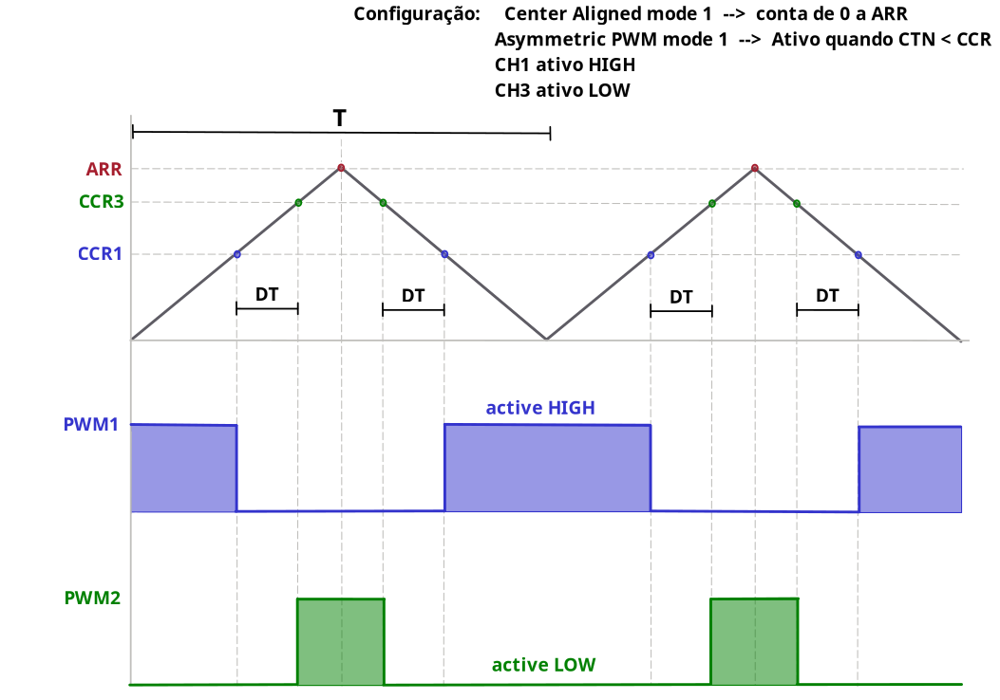
    </td>
    <td align="center">
    <h5>Figura 17: Entrada do driver</h5>
      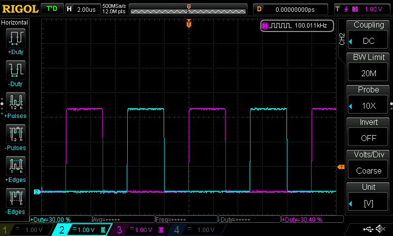
    </td>
  </tr>
</table>

### Transformador

Uma tensão de 12V foi colocada no primário para verificar a tensão de saída. Com 24V, o esperado é que a saída estivesse em torno de 316V pico-a-pico.

Este valor estava sendo alcançado já com 12V conforme mostra a Figura 18, indicando uma amplificação maior do que a esperada, portanto será necessário reduzir o número de voltas no secundário.

<h5>Figura 18: Tensão de saida</h5>
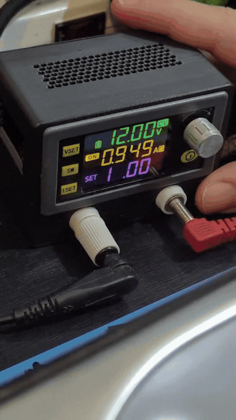

  

### Teste de Resistência Mecânica e Temperatura

O primeiro teste foi feito com uma média de 16W (16V/1A). O duty cycle estava configurado em 45%, mas os mosfets ultrapassaram 50ºC em aproximadamente 2 minutos, indicando que havia mais corrente reativa do que o esperado no primário.

Um mosfet apresenta um aumento de temperatura maior e mais rápido que outro, o que indica um possível desbalanço no núcleo do transformador. A Figura 19 mostra a tensão em ambas as bobinas do primário sobrepostas para verificar a simetria.

<h5>Figura 19: Simetria do núcleo</h5>
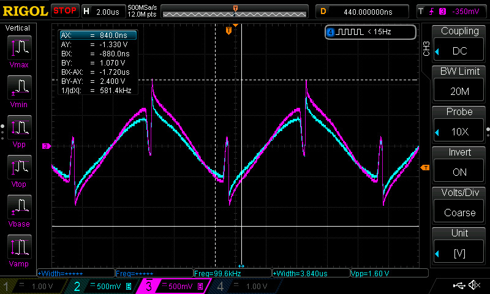

  

Pra mitigar isso, diminuímos o duty cycle progressivamente até chegar em 25%, onde a temperatura estabilizou bem em 50ºC com operação contínua, entregando 20W (20V/1A).

### Teste do Papel Alumínio

Alguns testes foram conduzidos com o papel alumínio para verificar a homogeneidade das ondas ultrassônicas. Se o papel alumínio apresentar uma textura rugosa uniforme, marcada por pequenos pontos, rugas e pequenos furos ou rasgos distribuídos por toda a área submersa então a energia está sendo transferida de forma homogênea. Nos testes conduzidos, o papel não apresentou mudanças muito perceptíveis.

### Teste de Limpeza

Os testes preliminares foram realizados com uma frequência fixa. Neste modo, era perceptível que ondas estacionárias estavam se formando pelo padrão no fundo da bacia e pela presença de minibolhas que permaneciam presas na mesma área, como mostrado respectivamente nas Figuras 20 e 21 (centro da imagem).

<h5>Figura 20: Ondas estacionárias</h5>
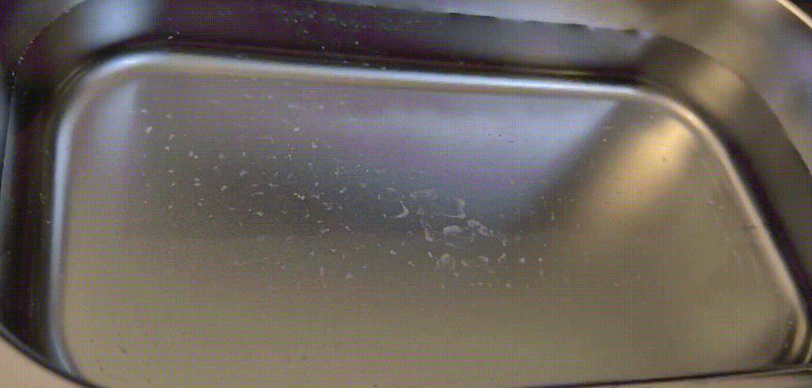

  

<h5>Figura 21: Minibolha presa</h5>
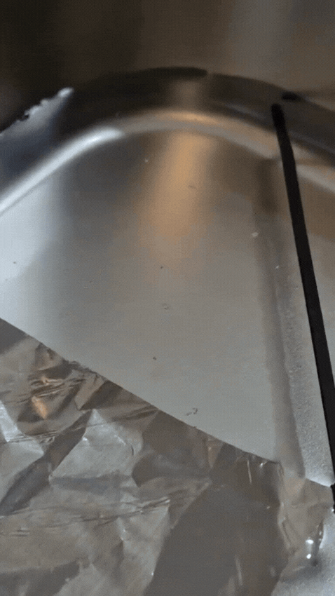

  

Para dispersar essas bolhas estacionárias, foi realizado um sweep de frequência, o que se mostrou eficaz conforme mostrado na Figura 22, onde há uma bolha no centro da imagem que se junta com outra e segue para a superfície.

O código para o teste pode ser acessado em [software](./software/main.c)

<h5>Figura 22: Minibolha sendo dispersada</h5>
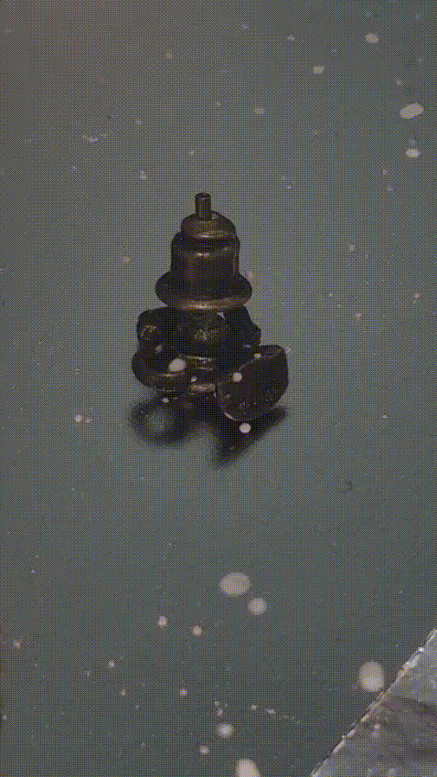

  

A Figura 23 mostra bolhas se formando ao redor do objeto solto no recipiente.

<h5>Figura 23: Bolhas na superfície do objeto</h5>
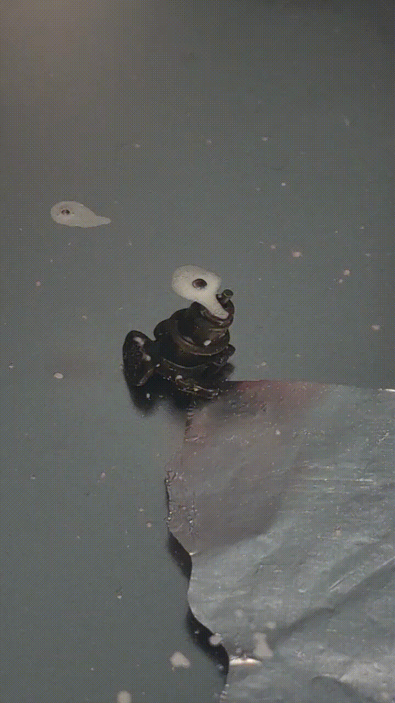

  

No entanto, após aproximadamente 20 minutos com o projeto energizado, os objetos dentro do recipiente não apresentaram diferenças significativas. Como os testes foram realizados apenas com água, é preciso testar novamente com produtos de limpeza diferentes e com um volume menor de líquido.

---

## Referências (links/datasheets/livros)

- [Push Pull Switching Transformer Design](https://cettechnology.com/push-pull-switching-transformer-design/)
- Projeto de Transformadores para Alta Frequênciapara Alta Frequência (Prof. Joabel Moia)
- [YUNYISONIC: High-Frequency Ultrasonic Cleaning in the Lab](https://www.yunyisonic.com/high-frequency-ultrasonic-cleaning-in-the-lab-when-and-why-it-matters/?srsltid=AfmBOopkQFBerbvCK0ieflRaHmwUs67991eDK0i3NRQh7iqhvNpcaU_K)
- [UVTools](https://github.com/sn4k3/UVTools)

