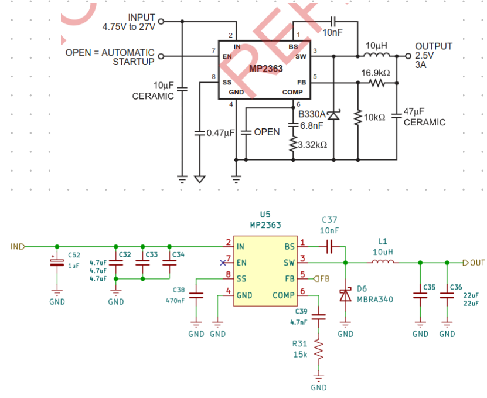
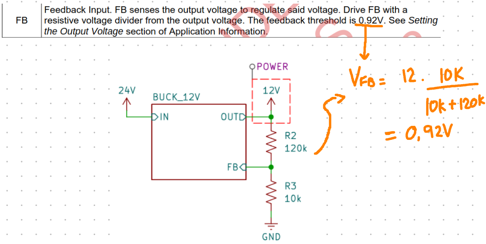
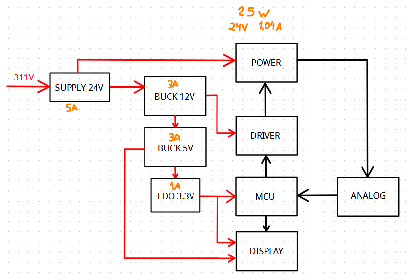

# Etapa 3

**(MÍNIMO DE 600 E MÁXIMO DE 1000 PALAVRAS no total do arquivo md.)**

A etapa 1 ...

**(Adicionar aqui UM parágrafo com visão geral da etapa. Resumo dos itens da planilha.)**

**(Não adicione código em nenhum arquivo md. )**

## 1. Montagem do Protótipo

Apresentar o desenvolvimento da etapa contendo detalhes de implementação (se houver) de hardware e software. Use fotos, diagramas, tabelas etc. Adicionar pesqusisas realizadas. Relacionar as fotos, diagramas, etc no texto. Todas as referências devem citadas no texto. 

### 1.1 Projeto de cada bloco

#### 1.1.1 Buck 12V
O conversor Buck reduz uma tensão CC contínua para uma tensão CC menor através do chaveamento de alta frequência de um transistor e do armazenamento de energia em um indutor e um capacitor.
Usamos o CI MP2363 para criar um ponto de 24V CC a partir da tomada (CA com 311V de pico) com base na aplicação típica mostrada no datasheet. 

Em seguida usamos um circuito buck para converter de 24V para 12V.

### 1.2 Layout da PCB

#### Descrição
<!-- Breve descrição do layout: número de camadas, dimensões, componentes principais, etc. -->

#### Diagrama Esquemático
<!-- Inserir imagem ou link para o esquemático -->

#### Layout das Trilhas
<!-- Inserir imagem do layout das trilhas (top/bottom) -->

#### Considerações de Projeto
<!-- Justificar escolhas: espessura, separação de trilhas, plano de terra, etc. -->

#### Lista de Componentes (BOM)
<!-- Inserir tabela com componentes, valores e encapsulamentos -->

---

### 1.3 Fabricação da PCB

#### Método de Fabricação
<!-- Descrever o processo utilizado (fresagem, corroão química, fabricante externo, etc.) -->

#### Parâmetros de Fabricação
<!-- Inserir dados: espessura da placa, acabamento, máscara de solda, etc. -->

#### Resultado
<!-- Inserir fotos da PCB fabricada (antes e depois da solda) -->

#### Problemas Encontrados
<!-- Descrever eventuais defeitos ou dificuldades -->

---

### 1.4 Fabricação do Transformador

#### 1.4.1 Especificações de Projeto 

As especificações de projeto são simplificadas na tabela abaixo: 

 

| Categoria | Parâmetro | Símbolo | Valor | Unidade | Observação |
| :--- | :--- | :--- | :--- | :--- | :--- |
| **Potência** | Potência do Piezo (Carga) | $P_{piezo}$ | 35 | W | |
| | Potência de Trabalho (Projeto) | $P$ | 30 | W | Superdimensionado para folga |
| **Primário** | Tensão do Primário | $V_{pri}$ | 24 | V | |
| | Corrente do Primário | $I_{pri}$ | 1,25 | A | |
| **Secundário** | Tensão do Secundário | $V_{sec}$ | 24,391 | V | |
| | Corrente do Secundário | $I_{sec}$ | 1,230 | A | |
| **Segurança** | Densidade de Corrente Segura | $J$ | 2 | A/mm² | |
| | Profundidade Pelicular (Pior caso) | $\delta$ | 0,16 | mm | Para frequência de 170 kHz |
| **Núcleo** | Tipo de Núcleo | - | ETD | - | Formato E duplo, cilindro central |
| | Fator de Indutância | $A_L$ | 0,4825 | $\mu H/espiras^2$ | Média obtida experimentalmente |
| | Área da Seção Transversal Efetiva | $A_e$ | 107 | mm² | Calculada com $D = 11$ mm |
| | Área da Janela do Carretel | $A_w$ | 288 | mm² | Calculada com $32 \times 9$ mm |

> Obs.: Para mais detalhes sobre como as especificações foram obtidas, clique [aqui](/etapa_3/especificacao_fundamentacao.md). As especificações do núcleo foram obtidas empíricamente, conforme descrito no arquivo.
 

#### 1.4.2 Dimensionamento da Bitola dos Cabos

Levando em consideração as especificações da tabela anterior, obteve-se os parâmetros de bitola para o primário e secundário, conforme a tabela abaixo.

| Parâmetro | Símbolo | Valor | Unidade | Observação / Equivalência |
| :--- | :--- | :--- | :--- | :--- |
| **Primário** | | | | |
| Diâmetro teórico mínimo | $D_{pri}$ | 0,8921 | mm | Calculado para $I = 1,25$ A |
| Diâmetro elementar | $D_{pri\,elem}$ | 0,5150 | mm | Calculado para $N=3$ |
| **Bitola comercial adotada** | - | **0,57** | **mm** | **Fio 23 AWG** |
| **Secundário** | | | | |
| Diâmetro teórico mínimo | $D_{sec}$ | 0,8849 | mm | Calculado para $I = 1,230$ A |
| Diâmetro elementar | $D_{sec\,elem}$ | 0,5109 | mm | Calculado para $N=3$ |
| **Bitola comercial adotada** | - | **0,51** | **mm** | **Fio 24 AWG** |

> Obs.: Para mais detalhes sobre como os parâmetros foram obtidos, clique [aqui](/etapa_3/especificacao_fundamentacao.md).

#### 1.4.4 Dimensionamento do número de Espiras

**Primário**: o número de espiras do primário é obtido pela lei de Faraday para uma onda quadrada:

$$
N_P = \frac{V_Pt_{on}}{4B_{max}A_e}
$$

Onde:
- $V_P$: tensão de pico aplicada em **metade** do primário;
- $t_{on}=TD$: tempo efetivo de condução, onde T é o período de onda, e D o duty cycle;
- $B$: densidade de fluxo magnético de projeto (com margem de segurança em relação ao $B_{max}$ do material)
- $A_e$: área da seção transversal efetiva do núcleo

.: A saturação do núcleo depende do produto tensão-tempo aplicado ao enrolamento (volt-segundo). O pior caso ocorre quando a tensão de entrada é máxima e o tempo de condução é máximo (50% do período).

**Secundário:** 

Pela relação de transformação do conversor push-pull:

$$
\frac{V_S}{V_P} = 2 \, \frac{N_S}{N_P}D
$$

$$
N_S = \frac{1}{2} \left( \frac{V_S}{V_P} \right) \left( \frac{N_P}{D} \right)
$$

O valor final deve ser **arredondado para cima**.

#### 1.4.5 Verificação da Área de Cobre

Antes de enrolar, é necessário confirmar que todo o cobre cabe fisicamente na janela do carretel. Calcula-se a **Área de Cobre Nua (BCA)** de cada enrolamento:

$$
BCA = \sum_{i} \left( N_i \cdot m_i \cdot \pi \, r_i^2 \right)
$$

Onde, para cada enrolamento $i$:
- $N_i$: número de espiras (considerando as duas metades quando houver tomada central)
- $m_i$: número de fios em paralelo por espira
- $r_i$: raio do fio elementar

Compara-se então com a área da janela do carretel ($A_w$):

$$
\text{Área Utilizada} = \frac{BCA}{A_w} \times 100
$$

**Critério de aprovação:** $BCA$ deve ficar entre $35\%$ e $40\%$ de $A_w$.

- $> 40\%$: o cobre não cabe $\rightarrow$ escolher núcleo/carretel maior
- $\ll 40\%$: núcleo superdimensionado $\rightarrow$ escolher núcleo menor

Os $60$–$65\%$ restantes são destinados a isolamento do esmalte, fator de empacotamento, fita isolante, tubos termorretráteis e espaços vazios.

#### Processo de Fabricação
<!-- Descrever o processo: enrolamento, isolamento, montagem do núcleo -->

#### Ensaio e Caracterização
<!-- Inserir resultados de medições: indutância, relação de espiras, perdas -->

#### Fotos
<!-- Inserir imagens do transformador montado -->

---

### 1.5 Montagem do Protótipo

#### Diagrama de Blocos do Sistema
<!-- Inserir diagrama: fonte + transformador + PCB + MPU + recipiente + piezo -->

#### Fixação do Piezoelétrico
<!-- Descrever método de fixação, material utilizado, posição -->

#### Construção da Cestinha
<!-- Descrever material, dimensões, método de fabricação, fotos -->

#### Integração dos Módulos
<!-- Descrever como os módulos foram conectados e acomodados -->

#### Código para Testes Básicos
<!-- Inserir trecho de código ou link para o repositório -->

#### Fotos da Montagem
<!-- Inserir imagens do protótipo montado -->

---

## 2 Testes e Ajustes

Descrição dos testes/validações realizadas. Use fotos, diagramas, tabelas, etc.

### 2.1 Testes

#### Teste de Resistência Mecânica e Temperatura
<!-- Descrever metodologia, equipamentos, resultados e análise -->

#### Definição do Material de Limpeza
<!-- Justificar escolha do líquido de limpeza e concentração -->

#### Teste do Papel Alumínio
<!-- Descrever metodologia, resultado (uniformidade da cavitação) e imagens -->

#### Teste de Limpeza
<!-- Descrever objetos utilizados, sujidade aplicada, resultado obtido e análise -->

#### Tabela Resumo dos Testes

| Teste | Condição | Resultado | Observações |
| :--- | :--- | :--- | :--- |
| | | | |

---

### 2.2 Ajustes de Projeto

#### Ajustes Realizados
<!-- Listar e descrever cada ajuste aplicado após os testes -->

#### Justificativa Técnica
<!-- Explicar o motivo de cada ajuste com base nos resultados dos testes -->

#### Resultado Final
<!-- Inserir fotos ou medições após os ajustes -->

#### Lições Aprendidas
<!-- Registrar dificuldades, soluções e recomendações para projetos futuros -->

---

## Referências (links/datasheets/livros)

- [nRF Connect SDK](https://developer.nordicsemi.com/nRF_Connect_SDK/doc/2.4.2/nrf/getting_started/modifying.html#configure-application>)

