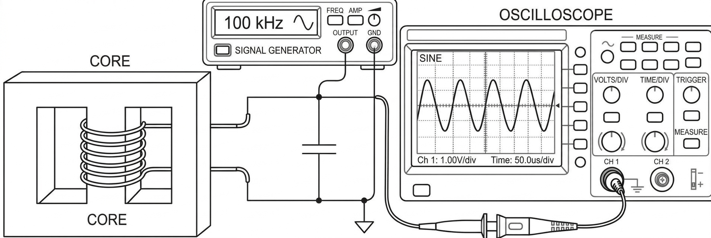
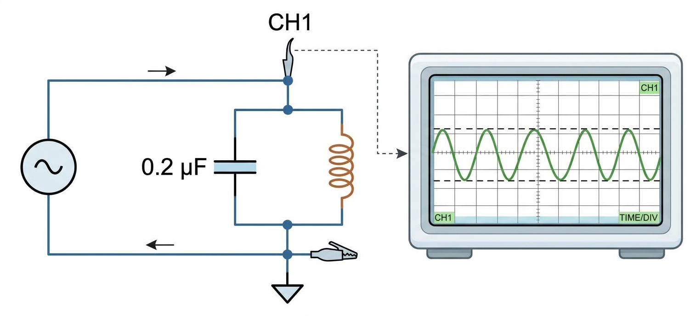
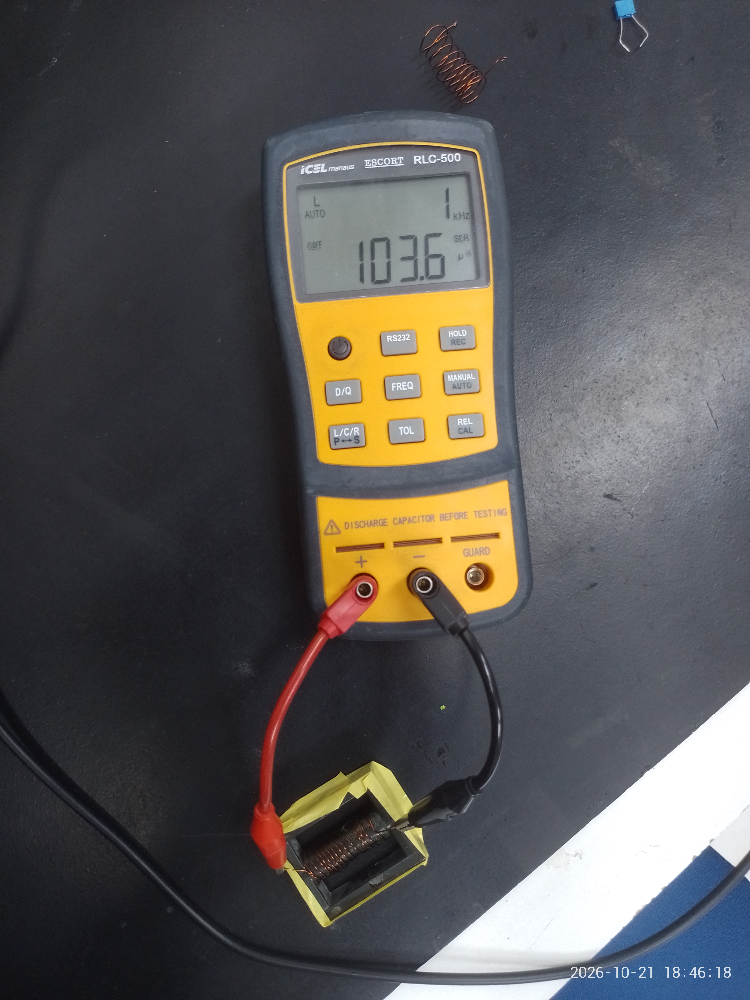
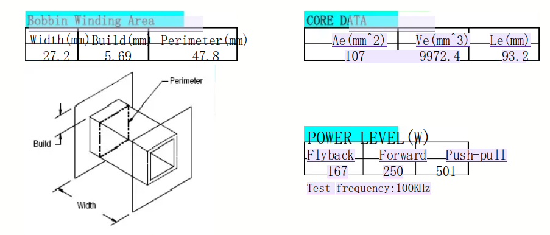

# Fundamentação teórica
Levando em conta o volume de informações necessárias na etapa 3, torna-se necessário a criação deste material de apoio.

## Especificações de Projeto

### Potência de trabalho, superdimensionamento e fatores de segurança:

Razão potência-tanque usual: $8$ a $15W/L$;  
O que temos:  
- Potência do piezo: $35W$  
- Volume do recipiente: $1,3L$  
- Faixa de potência: $10,4 \,a \,19,5W$  

Com o intuito de trabalharmos com folga e ter a oportunidade de testar os limites da limpadora, optou-se por superdimensionar a potência($25W$), deixando para controlar o limite desejado via software: 
> Obs: A resistência de ressônancia do pizoelétrico mudou para $324 \Omega$ com a bacia acoplada. 

- Primário:  
  - $V_{pri} = 24V$  
  - $I_{pri}=I= \frac{P}{V} = \frac{30}{24} = 1,25A$  

- Secundário:
  - $V_{secRMS} =V= \sqrt{PR} = \sqrt{25 \cdot 324} = 90V$  
  - $I_{secRMS} =I= \frac{V}{R} = 5/18 \approx 277,8mA$  

Parâmetros de segurança:

A profundidade pelicular $\delta$ é dada por

$$
\delta = \sqrt{\frac{\rho}{\pi f \mu}}
$$

Onde:
- $\delta$ = Profundidade pelicular $m$
- $\rho$ = Resistividade do material ($\Omega \cdot m$)
- $f$ = Frequência ($Hz$)
- $\mu = \mu_0 \mu_r =$ Permeabilidade magnética absoluta ($H/m$)

Para o cobre a 20 °C (não-magnético, $\mu_r \approx 1$), a aproximação prática é:

$$
\delta_{Cu} \approx \frac{66}{\sqrt{f}} \quad [\text{mm}]
$$

- Profundidade pelicular para o pior caso($100kHz$): $\delta \approx 0,2063mm$
- Densidade de corrente segura: $J \geq 2 \, \text{A/mm}^2$  

### Caracterização do núcleo:

O núcleo foi obtido de um transformador da série ERL35, com as seguintes características disponíveis:  

**Núcleo:** ETD (formato "E" duplo, com cilindro central).  
**Área da Seção Transversal Efetiva ($A_e$):** $107mm^2$. Esta área define o fluxo magnético máximo antes da saturação.  

Algumas especificações referentes ao núcleo são obtidas de forma empírica: 

#### Fator de indutância $A_L$:

 Através da equação genérica da indutância:

$$
L = \frac{\mu_0 \mu_r N^2 A_e}{l_e} = \left(\frac{\mu_0 \mu_r A_e}{l_e}\right)N^2
$$

$$
A_L = \frac{L}{N^2} = \frac{\mu_0 \mu_r A_e}{l_e}
$$

Onde:
- $A_L$ = fator de indutância $[\mu H/espiras^2]$(*dependente apenas das características do núcleo*);
- $\mu_0$ = permeabilidade do vácuo;
- $\mu_r$ = permeabilidade relativa;
- $N$ = espiras;
- $A_e$ = área efetiva da seção transversal;
- $l_e$ = comprimento efetivo do caminho magnético;
- $L$ = indutância característica da bobina.

$A_L$ pode ser inferido através da indutância de magnetização, que é obtida de duas formas, por uma configuração tanque LC, conforme as figuras abaixo, ou ainda, através de uma ponte LCR.   

<h5>Figura 1 - Caracterização do núcleo</h5>

   

<h5>Figura 2 - Caracterização do núcleo 2</h5>

   

Com C conhecido, varia-se a frequência do sinal até encontrar a frquência de ressonância, onde a tenção é máxima:

$$
f = \frac{1}{2\pi\sqrt{LC}} \Rightarrow L = \frac{1}{(2\pi f)^2 C}
$$

> Obs: Recalcular para valores do núcleo novo

Calculando-se para 145kHz e 47kHz, com 5 e 15 voltas, obteve-se $A_L = 0.499\mu$ e $A_L = 0.466\mu$. Tirando a média:

$$
A_L = 0,4825\mu \,H/espiras^2
$$

Ainda, conhecendo o número de espiras, também é possível encontrar $A_L$ pela ponte LCR, conforme figura abaixo:

<h5>Figura 3 - Medição de L através da ponte LCR</h5>

   

> Obs: devido à variação de temperatura, L ficou variando, mas seu valor médio é usado na equação abaixo.
$$
A_L = \frac{103,5\mu \,H}{15^2} = 0,46\mu \,H/espiras^2
$$

#### Área da Seção Transversal Efetiva ($A_e$) e Área da Janela do Carretel ($A_w$)

Através do datasheet do transformador, obten-se $A_e$ e $A_w$, conforme a figura 3:  

<h5>Figura 3 - Diâmetro do núcleo</h5>

   

$$A_e = 107mm^2 $$
$$
A_w = l \cdot h = 27,2 \cdot 5,69 = 154,8 mm^2
$$

## Dimensionamento da Bitola dos Cabos

$$A = \pi r^2 \text{ e } J = I/A$$
Com um pouco de algebrismo e evidenciando $D$:
$$ D = 2 \sqrt{\frac{I}{J\pi}} $$
 

*Bitola teórica mínima:*  

$ D_{pri} = 2 \sqrt{\frac{1,25}{2\pi}} \approx 0,8921\text{mm}$  
$ D_{sec} = 2 \sqrt{\frac{1,230}{2\pi}} \approx 0.8849 \, \text{mm}$  

Considerando a profundidade pelicular($\delta$), e o número de cabos bifilares $N$, pode-se estimar a bitola:  

$$N=\frac{A_{teórica}}{A_{cabo\,elementear}}$$
$$N=\frac{4\pi D_{teórica}^2}{4\pi D_{cabo\,elementear}^2}=\frac{D_{teórica}^2}{D_{cabo\,elementear}^2},\,\, D_{cabo\,elementear} \leq 2\delta$$
$$$$

*Bitola elementar:*  

$$D_{cabo\,elementear}=\frac{D_{teórica}}{\sqrt{N}}$$

Para $N=3\,\text{e}\,\delta \approx 0,2063mm$:

$D_{pri\,elementar}=\frac{0,8921}{\sqrt{3}} \approx 0,5150mm$

.: $D_{pri\,elementar} \approx 0,57mm$, $23AWG$

$D_{sec\,elementar}=\frac{0,8849}{\sqrt{3}} \approx 0,5109mm$

.: $D_{sec\,elementar} \approx 0,51mm$, $24AWG$

## Dimensionamento das espiras

O número de espiras do primário é obtido pela lei de Faraday:

$$
V_{max}(t) = N \frac{d\Phi_{max}}{dt}
\quad\Longrightarrow\quad
\int V(t)\,dt = N \Delta \Phi_{max}
$$

Para uma onda quadrada, chegamos no módulo da tensão autoinduzida:

$$
V_{rms}= V_{pico} = 4 f N A_e B_{max} = V_{pico} = \frac{4 N A_e B_{max}}{t_{on}}
$$

$$
N = \frac{V_{max}t_{on}}{4B_{max}A_e}
$$

Onde:
- $V_{pri}$: tensão aplicada em **metade** do primário;
- $t_{on}=TD$: tempo efetivo de condução, onde T é o período de onda, e D o duty cycle;
- $B$: densidade de fluxo magnético de projeto (com margem de segurança em relação ao $B_{max}$ do material)
- $A_e$: área da seção transversal efetiva do núcleo

.: A saturação do núcleo depende do produto tensão-tempo aplicado ao enrolamento (volt-segundo). O pior caso ocorre quando a tensão de entrada é máxima e o tempo de condução é máximo (50% do período).

**Primário**: (substituir valores)

$$
N_P = \frac{V_Pt_{on}}{4B_{max}A_e}
$$

**Secundário:** (substituir valores)

Pela relação de transformação do conversor push-pull:

$$
\frac{V_S}{V_P} = 2 \, \frac{N_S}{N_P}D
$$

$$
N_S = \frac{1}{2} \left( \frac{V_S}{V_P} \right) \left( \frac{N_P}{D} \right)
$$

O valor final deve ser **arredondado para cima**.