# Hardware

Neste documento estarão detalhados alguns cálculos e referências seguidos para a prototipagem do projeto de acordo com o diagrama de blocos da Figura 1.

<h5>Figura 1: Breve diagrama de blocos</h5>
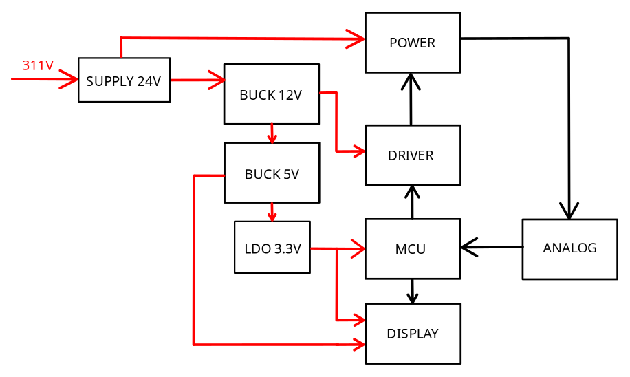

  

## Buck 12V

O conversor Buck reduz uma tensão CC contínua para uma tensão CC menor através do chaveamento de alta frequência de um transistor e do armazenamento de energia em um indutor e um capacitor.
Usamos o CI MP2363 (Figura 2) para criar um ponto de 12V CC a partir de 24V de alimentação de uma fonte, com base na aplicação típica mostrada no [datasheet](https://www.monolithicpower.com/en/documentview/productdocument/index/version/2/document_type/Datasheet/lang/en/sku/MP2363/?srsltid=AYCX9vLj0Yd7um0Egu9H57R6vaFL04rclYFHzbOqzPCZu6mk2dfonHHz).

<h5>Figura 2: Buck 12V - MP2363</h5>
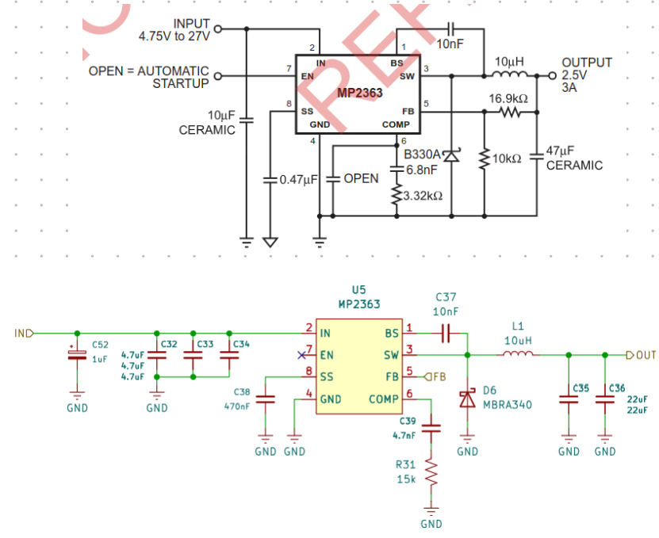

  

A partir da tensão de saída desejada e do valor de feedback conforme o datasheet, calculamos os resistores para a conversão. A Figura 3 demonstra os cálculos retirados do datasheet que validam os valores dos resistores escolhidos.

<h5>Figura 3: Buck 12V - Feedback</h5>
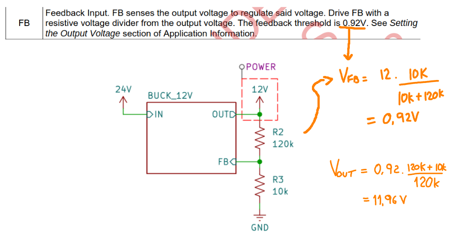

  

## Buck 5V 

Similarmente, usamos o CI TPS563201 para criar um ponto de 5V CC a partir de 12V de alimentação do bloco anterior com base na aplicação típica mostrada no [datasheet](https://www.ti.com/lit/ds/symlink/tps563201.pdf?ts=1792653573582&ref_url=https%253A%252F%252Fwww.google.com%252F).

<h5>Figura 4: Buck 5V - TPS563201</h5>
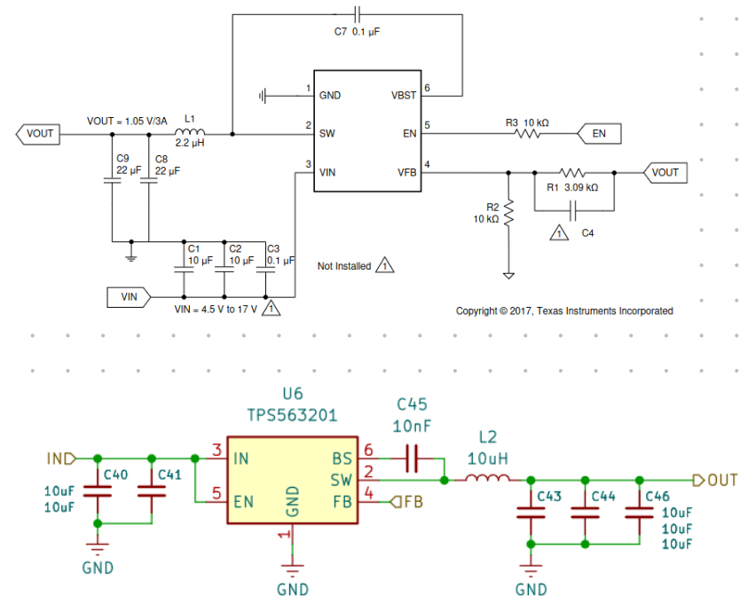

  

<h5>Figura 5: Buck 5V - Feedback</h5>
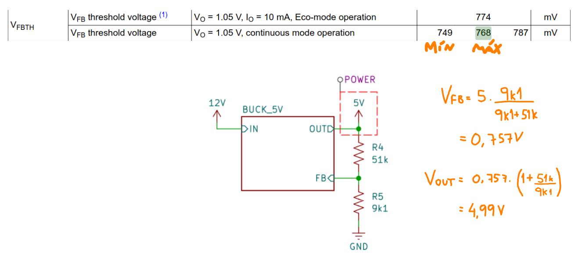

  

## IHM

Como documentado na [etapa 2](../etapa_2/hardware/README.md), o display é alimentado com 5V do bloco anterior. Um conversor de nível lógico realiza a conversão para 3.3V para comunicação com o microcontrolador. Um encoder é conectado ao microcontrolador para atuar como interface que permite ao usuário se comunicar com o microcontrolador, selecionando a opção dessejada ao girar e confirmando ao apertar o botão.

<h5>Figura 6: Esquemático da placa do painel</h5>
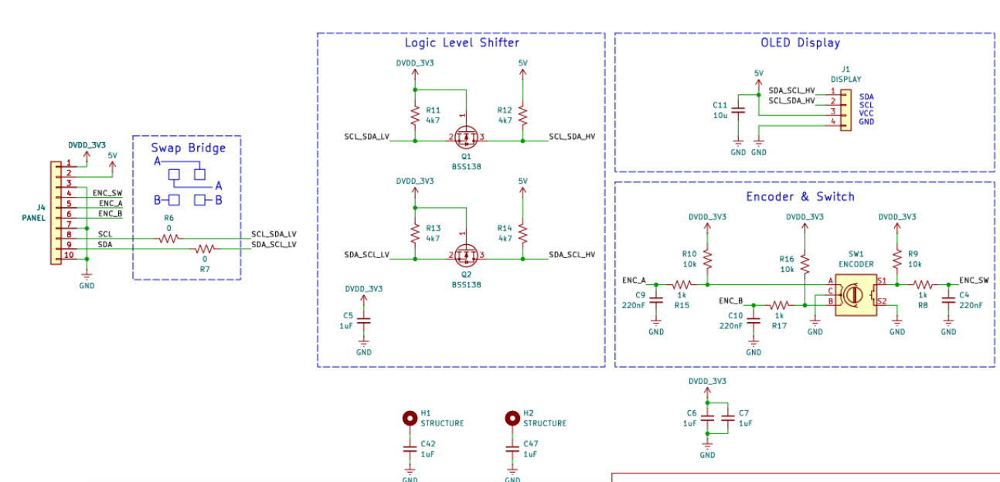

  

## Push-Pull

A Figura 7 mostra o transformador push-pull e a Figura 8 traz os cálculos preliminares básicos para visualizarmos valores esperados e limites de operação.

<h5>Figura 7: Push-Pull</h5>
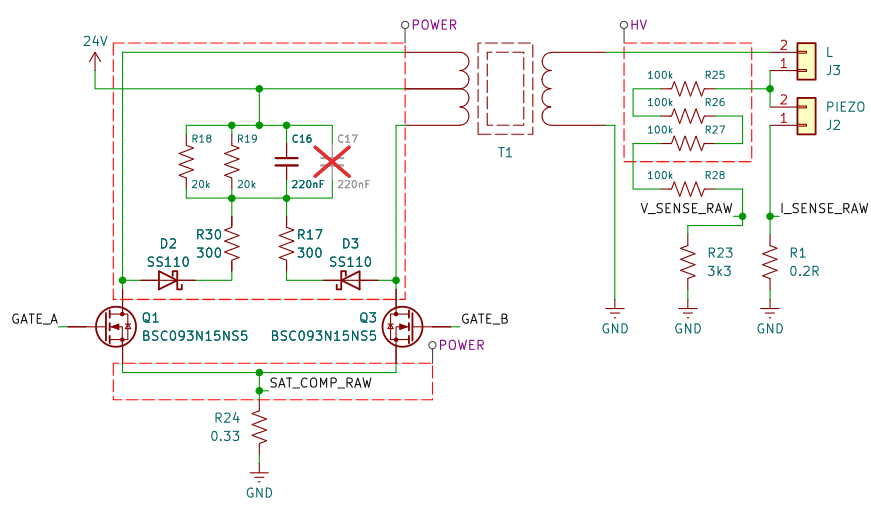

  

<h5>Figura 8: Cálculos preliminares</h5>
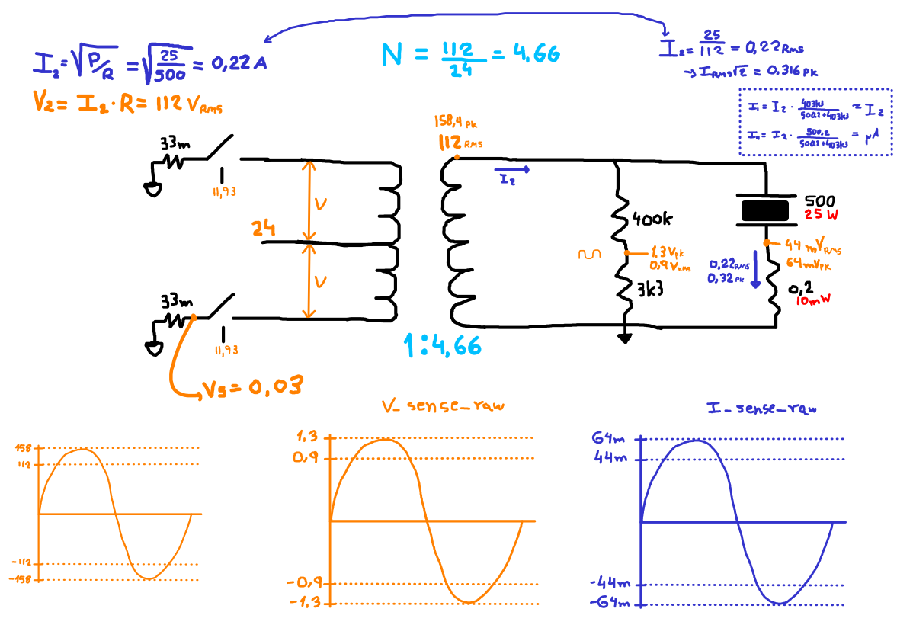

  

## MCU (Cristal)

O cristal fo iinserido no esquemático seguindo a aplicação típica do datasheet DocID026415 Rev 5, conforme a Figura 17. 

<table align="center">
  <tr>
    <td align="center">
    <h5>Figura 9: Esquemático</h5>
      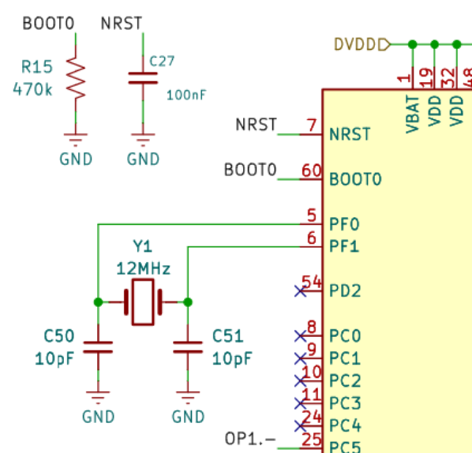
    </td>
    <td align="center">
    <h5>Figura 10: Aplicação típica</h5>
      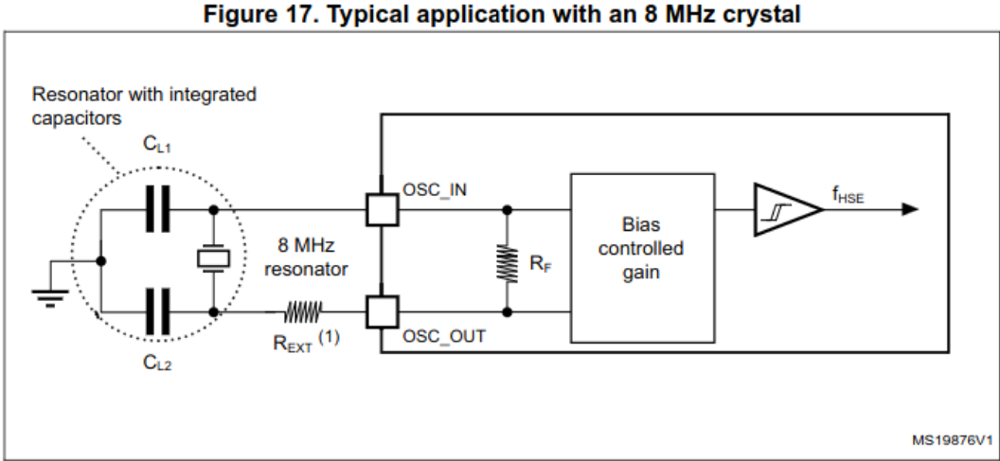
    </td>
  </tr>
</table>

## Sensoriamento (ANALOG)

Este bloco opcional foi projetado para realizar o sensoriamento de tensão e corrente do cristal para assim conseguirmos informações como defasamente entre as ondas. Conhecendo o defasamento, é possível rastrear a frequência onde a fase é 0º, indicando a ressonância do cristal.

A partir dos cálculos preliminares apresentados na Figura 8, teremos um swing de tensão esperado nos shunts de corrente e tensão conforme a Figura 9:

<h5>Figura 9: Swing esperado</h5>
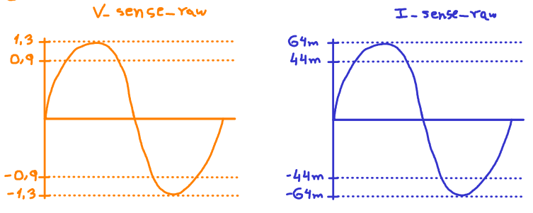

  

Como a saída do cristal é uma senoide AC, para fazer o sensoriamento pelo ADC precisamos aplicar um bias DC, neste caso de 1.65V conforme a Figura 10.

<h5>Figura 10: Bias DC</h5>
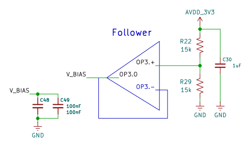

  

A Figura 11 mostra o AmpOp interno para o sensoriamento de tensão.

Como temos em $V_{sense_{RAW}}$ uma senoide de 2.6V pico-a-pico e considerando um ADC com limite superior de entre 2.5V e 3V, um ganho unitário é o suficiente para a medição.

Calcularemos também o filtro de entrada para que a atenuação do sinal seja unitária.

$$f_c = \frac{1}{2 \pi RC} = \frac{1}{2 \pi * 15k * 220n} = 48$$

$$|H| = \frac{(\frac{f}{f_c})}{\sqrt{1+ (\frac{f}{f_c})²}} = \frac{(\frac{100k}{48})}{\sqrt{1+ (\frac{100k}{48})²}} = 0.99$$

<h5>Figura 11: Sensorimento de tensão</h5>
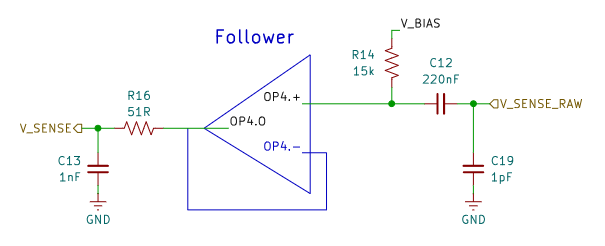

  

Assim, a onda resultante será uma senoide DC com swing entre 0.35V e 2.92V, dentro dos limites do ADC.

A mesma lógica será aplicada ao sensoriamento de corrente, mostrado na Figura 12.

<h5>Figura 12: Sensorimento de corrente</h5>
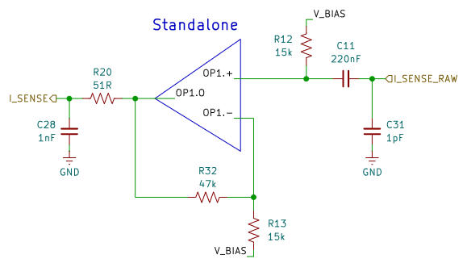

  

No entanto, após aplicar o bias DC, o swing será de menos de 130mV, estando entre 1.57V e 1.7V. Como estamos medindo apenas a informação de fase, a amplitude da onda em si não é essencial para a medição, mas amplificar o sinal evitará que o meio influencie em demasia a medição, o que pode acontecer com sinais muito pequenos. Assim,  aplicamos um ganho no AmpOp interno.

Para deixar similar ao sensoriamento de tensão:

$$2.93V - 0.35V = 2.58V \text{ de ondulação}$$

$$G = \frac{2.58}{127m} \approx 20$$

Fixando o resistor em 15k (resistor de bias):

$$G = 1 + \frac{Rf}{15k} \rightarrow Rf = 270k$$

Assim, resistores de ganho de 15kΩ e 270kΩ deixam um ganho de 19, o suficiente para respeitar o limite do ADC e deixar o sinal entre 0.43V e 2.86V.

Diferente do AmpOp de tensão, como o de corrente introduz um ganho é necessário referenciar o feedback em relação a tensão de bias para que o ganho não seja amplificado junto com o sinal.

## Sensoriamento do primário

Outro sensoriamento opcional útil de se fazer é a corrente no primário do transformador para monitorar a saturação do núcleo. Esse sensoriamento é feito pelo shunt no source dos mosfets. 

Conforme mostra a Figura 13, o sinal bruto passa por um filtro que resultas em $f_c = 3.1MHz$ e $|H|= 0.031$. Há um compromisso a se fazer entre a frequência de corte e a atenuação do sinal para que ambos estejam equilibrados.

<h5>Figura 13: Saturação</h5>
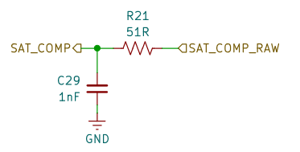

  

Conforme a corrente no primário aumenta, a tensão no shunt de 33mΩ aumentará proporcionalmente:

| Corrente no primário (A)| Tensão no shunt (mV)|
|:-:|:-:|
|0.5|16.5|
|1|33|
|2|66|
|...|...|

  

No comparador do microcontrolador, quando a tensão no shunt for maior que a tensão configurada via firmware no DAC as chaves serão desligadas.
Isto é particularmente útil no caso de um push-pull onde é comum problemas de flux walking, que pode acontecer quando uma chave fica mais tempo em condução do que a outra, acumulando um bias DC depois de um tempo de operação e podendo levar à saturação do núcleo.

---

## Referências (links/datasheets/livros)

[RF Man Discusses Core Saturation Of Inductors and Ferrite Materials](https://www.youtube.com/watch?v=5iOkFIJcj2s&t=1s)